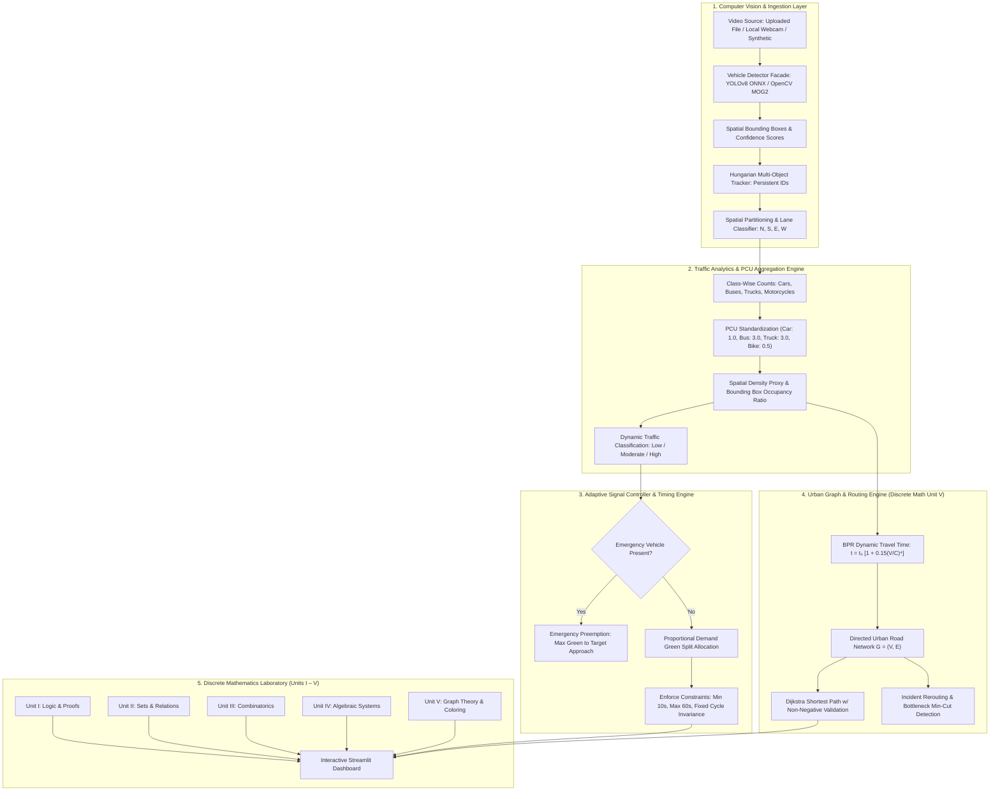

# 🚦 AI-Based Smart Traffic Management System Using Video Analytics and Graph Theory

> **Department of Computer Science & Engineering | 2nd Year B.Tech Academic Capstone Project**  
> **Course Mapping:** Discrete Mathematics (All 5 Units) & Applied Computer Vision  
> **Primary Technology Stack:** Python 3.10–3.14+, OpenCV, Streamlit, NetworkX, Plotly, NumPy, Pandas, SciPy

---

## 📌 Executive Summary

Urban vehicular congestion leads to billions in wasted fuel, excess carbon emissions, and dangerous delays for emergency first responders. Conventional municipal traffic intersections operate on **Webster's fixed-time pre-timed cycles**, which are completely blind to sudden traffic spikes, directional lane imbalances, or emergency priority vehicles.

This project introduces a complete, closed-loop intelligent transportation system that fuses **Real-Time Computer Vision**, **Rule-Based Adaptive Traffic Signal Optimization**, **Macro-Level Urban Graph Modeling**, and a **Comprehensive Discrete Mathematics Laboratory** covering all five syllabus units.

---

## 🏛️ System Architecture

The application is structured into five cohesive, loosely coupled architectural layers:



---

## 📁 Repository Directory Structure

```text
smart-traffic-management/
├── app.py                           # Executive Dashboard, system status, model inspector & navigation
├── requirements.txt                 # Clean, compatible dependencies (Python 3.10 - 3.14+)
├── README.md                        # Comprehensive documentation, setup guide & syllabus mapping
├── .gitignore                       # Excludes venvs, caches, temporary media, large weights & secrets
├── models/                          # Pretrained neural network binaries
│   └── yolov8n.onnx                 # YOLOv8 Nano ONNX model (COCO vehicles, 12.8 MB)
├── modules/                         # Core algorithmic and mathematical backend
│   ├── __init__.py                  # Package exports
│   ├── camera_stream.py             # Hardware camera capture abstraction & MockCameraStream
│   ├── video_processor.py           # Frame sampling, tripwire line crossing, ROI check & synthetic traffic
│   ├── vehicle_detector.py          # Real YOLOv8 ONNX, Hungarian tracker, MOG2 & HUD overlays
│   ├── traffic_analyzer.py          # PCU calculation, queue lengths & historical KPI aggregation
│   ├── signal_optimizer.py          # Webster static baseline vs AI proportional adaptive splits
│   ├── graph_model.py               # Directed network G=(V,E), BPR equation, Dijkstra, Max-Flow
│   └── discrete_math.py             # Complete Discrete Mathematics implementation (Units I - V)
├── pages/                           # Streamlit multi-page user interface
│   ├── 1_Video_Analysis.py          # Uploaded video file and synthetic stream processing
│   ├── 2_Live_Camera.py             # Local OpenCV webcam capture & browser snapshot streaming
│   ├── 3_Traffic_Analytics.py       # Time-series trends, density proxies, LOS & delay reduction
│   ├── 4_Intersection_Graph.py      # Urban grid network, Dijkstra routing, incident injection
│   ├── 5_Discrete_Mathematics_Lab.py# Comprehensive academic lab for Units I–V & Viva Voce guide
│   └── 6_Project_Information.py     # System methodology, formal specs, limitations & roadmap
├── visualizations/                  # Interactive visual components & design tokens
│   ├── __init__.py                  # Package exports
│   └── charts.py                    # Plotly charts & Dark Navy / Cyan glassmorphism styling
├── data/                            # Benchmark datasets
│   └── sample_traffic.csv           # Multi-approach historical traffic records
└── tests/                           # Complete automated unit test suite (102/102 Passing)
    ├── test_camera_stream.py        # Camera hardware lifecycle, index selection & mock fallback
    ├── test_vehicle_detector.py     # YOLOv8 DNN, Hungarian tracking, non-double-counting & HUD
    ├── test_video_processor.py      # Frame sampling, tripwires, ROI containment, corruption handling
    ├── test_traffic_analyzer.py     # PCU weighting, density proxy, LOS classification & KPIs
    ├── test_graph_model.py          # Directed/undirected matrices, BFS, Dijkstra, BPR impedance
    ├── test_signal_optimizer.py     # Cycle budget invariance, min/max green, emergency preemption
    └── test_discrete_math.py        # All 5 units: Logic, Sets, Combinatorics, Groups, Graph Theory
```

---

## 📐 Discrete Mathematics Syllabus-to-Feature Mapping Table

This project directly maps the complete 5-Unit undergraduate **Discrete Mathematics (CS204 / C301)** syllabus to practical computer vision and civil traffic systems:

| Syllabus Unit & Topic | Mathematical Formulation | Application & Code Implementation |
| :--- | :--- | :--- |
| **UNIT I: LOGIC & PROOFS** | | |
| Propositions & Truth Values | $P \wedge Q \to S$ | Congestion inference rules: High Density ($P$) $\wedge$ Long Queue ($Q$) $\to$ Extend Green ($S$). |
| Truth Tables & Normal Forms | Full valuation tables, DNF / CNF minterm decomposition | Generates full 16-row truth tables for traffic rules, computing canonical Sum of Products (DNF) and Product of Sums (CNF). |
| Logical Equivalence & De Morgan | $\neg(P \vee Q) \equiv \neg P \wedge \neg Q$ | Proves equivalence between compound traffic sensor trigger conditions. |
| Rules of Inference | Modus Ponens, Modus Tollens, Disjunctive Syllogism | Formal proof system validating traffic controller decisions and safety state guarantees. |
| **UNIT II: SETS & RELATIONS** | | |
| Set Operations & Power Sets | $A \cup B$, $A \cap B$, $A \setminus B$, $\mathcal{P}(A)$ | Vehicle set partitioning across intersection approaches; cardinality tracking. |
| Cartesian Product & Relations | $A \times B = \{(a, b) \mid a \in A, b \in B\}$ | Mapping observed vehicles to approach lanes ($V \times L$); $|V \times L| = |V| \cdot |L|$. |
| Equivalence Relations & Classes | Reflexive, Symmetric, Transitive ($[x]$) | "Same-Lane" relation partitions active traffic into disjoint equivalence classes (North, South, East, West). |
| Poset, Hasse Diagram & Lattice | Partial Order $(\le)$, GLB ($\wedge$), LUB ($\vee$), Bounded Lattice | Priority hierarchy of road users: Emergency $\succ$ Public Transit $\succ$ Commercial $\succ$ Private $\succ$ Pedestrian. |
| Boolean Algebra | Complementation, Identity, Absorption | Logic circuit reduction for sensor fusion and collision avoidance rules. |
| **UNIT III: COMBINATORICS** | | |
| Permutations & Combinations | $P(n, r) = \frac{n!}{(n-r)!}$, $C(n, r) = \binom{n}{r}$ | Non-conflicting signal phase sequencing orderings ($n!$) and lane sensor combination selections. |
| Pigeonhole Principle (PHP) | $\lceil n / k \rceil$ items per container | Proves that with $n$ vehicles distributed across $k$ lanes, at least one lane contains $\ge \lceil n/k \rceil$ vehicles. |
| Principle of Inclusion-Exclusion | $|A \cup B \cup C| = \sum |A| - \sum |A \cap B| + |A \cap B \cap C|$ | Eliminates double-counting across overlapping camera detection zones and sensor tripwires. |
| Mathematical Induction | Base Case $P(1)$, Inductive Step $P(k) \to P(k+1)$ | Rigorous induction proof that an acyclic arterial corridor of $n$ junctions requires $n - 1$ signalized links. |
| **UNIT IV: ALGEBRAIC SYSTEMS** | | |
| Binary Operations & Semigroups | Closure, Associativity, Identity ($e$), Inverse ($a^{-1}$) | Four-phase cyclical signal controller modeled as cyclic group $(\mathbb{Z}_4, +_4)$. |
| Groups & Klein 4-Group | $V_4 = \{e, a, b, c\}$ where $x^2 = e$ | Models independent paired orthogonal traffic phases (NS vs EW vs Green vs Red). |
| Homomorphisms & Kernels | $f(a \cdot b) = f(a) * f(b)$, $\ker(f)$ | State-space abstraction mapping micro-states (vehicle counts) to macro-states (Level of Service). |
| Vector Spaces & Linear Independence | $\sum c_i v_i = 0 \iff c_i = 0$, Matrix Rank | Analyzes traffic flow vector spaces across intersection approaches; verifies linear independence. |
| **UNIT V: GRAPH THEORY** | | |
| Graph Modeling & Representations | $G = (V, E)$, Adjacency Matrix $A$, Incidences | Vertices $V$ = Junctions; Edges $E$ = Road segments; binary and weighted adjacency matrices. |
| Handshaking Lemma & Degrees | $\sum_{v \in V} \deg(v) = 2|E|$ | In-degree and out-degree conservation across directed road intersections. |
| Path Walk Theorem | $(A^k)_{ij}$ = number of walks of length $k$ | Computes exact number of alternate arterial routes between junctions using matrix powers $A^k$. |
| Graph Isomorphism | $f: V_1 \to V_2$ preserving adjacency | Structural equivalence testing between intersection geometries. |
| Shortest Path (BFS & Dijkstra) | $O((V + E) \log V)$ with strictly non-negative weights | BFS for minimum hop count; Dijkstra for minimum BPR congestion-weighted travel time. |
| Spanning Trees (MST) | Kruskal / Prim Algorithm ($O(E \log E)$) | Minimum cabling cost for municipal traffic fiber communications infrastructure. |
| Vertex Coloring & Welsh-Powell | Chromatic Number $\chi(G)$ | Conflict graph coloring where conflicting turn movements receive distinct non-overlapping green phases. |
| Planarity & Euler's Formula | $V - E + F = 2$, Kuratowski's Theorem ($K_5, K_{3,3}$) | Proves grade-separation requirement (flyovers/underpasses) when edge density exceeds $3V - 6$. |
| Eulerian & Hamiltonian Graphs | Euler Circuits (even degrees) & Hamiltonian Cycles | Route optimization for police patrol rounds and maintenance inspection circuits. |
| Network Flow & Bottlenecks | Ford-Fulkerson Max-Flow Min-Cut Theorem | Computes max hourly throughput and locates critical road bottlenecks. |
| Spectral Graph Theory | Graph Laplacian $L = D - A$, Fiedler value $\lambda_2$ | Algebraic connectivity of road networks and resilience against bridge closures. |

---

## 🚗 Computer Vision & Vehicle Detection Pipeline

### 1. Dual-Backend Detection Architecture
The system employs a unified `VehicleDetectorFacade` with two interchangeable backends:
1. **Pretrained YOLOv8 Nano DNN (`models/yolov8n.onnx`):**
   - High-speed neural detection running on native OpenCV DNN (`cv2.dnn.readNetFromONNX`).
   - Resolves COCO classes: Cars (PCU 1.0), Motorcycles (PCU 0.5), Buses (PCU 3.0), Trucks (PCU 3.0).
   - Input size: $640 \times 640$ RGB normalized; configurable confidence threshold ($0.25 - 0.90$).
   - Completely standalone: **Zero external PyTorch or CUDA dependencies required**.
2. **OpenCV Background Subtraction & Contour Analysis (Fallback):**
   - Gaussian Mixture Model MOG2 foreground segmentation with morphological noise filtering.
   - Operates instantaneously even on low-power devices with zero neural weights required.

### 2. Multi-Object Tracking (MOT) & Anti-Double-Counting
- **Algorithm:** Two-stage matching using the Hungarian assignment algorithm (`scipy.optimize.linear_sum_assignment`):
  - Primary metric: Bounding box Intersection-over-Union (IoU $\ge 0.25$).
  - Secondary fallback: Centroid Euclidean proximity threshold ($d \le 85\text{ px}$).
- **Persistent Track IDs:** Vehicles entering the scene receive permanent IDs (e.g., `#1`, `#2`).
- **Stopped Vehicle Protection:** Vehicles waiting at red lights maintain persistent IDs and are **never repeatedly counted as new arrivals**.

### 3. Metric Distinctions
- **Unique Tracks ($|T_{\text{unique}}|$):** Cumulative count of distinct physical vehicles observed over the session.
- **Vehicles Visible in Frame ($N(t)$):** Instantaneous spatial occupancy at timestamp $t$. Used for immediate green light split calculations.
- **Estimated Flow Rate ($q$):** Dynamic vehicles-per-minute rate crossing user-defined virtual tripwire counting lines.
- **Spatial Density Proxy:** Vehicles per unit normalized region area ($N / A$).

---

## 🔀 Video Analysis vs. Live Camera: Workflow Comparison

The application provides two completely separated, purpose-built workflows:

| Feature / Aspect | 🎬 Uploaded Video Analysis (`1_Video_Analysis.py`) | 📹 Live Camera Stream (`2_Live_Camera.py`) |
| :--- | :--- | :--- |
| **Input Source** | Pre-recorded file (`.mp4`, `.avi`, `.mov`) or Synthetic Benchmark | Local USB / built-in webcam or Browser camera stream |
| **Temporal Control** | Start, Pause, Stop, Seek, Reset, and Frame-Step controls | Real-time continuous streaming with Start / Stop toggle |
| **Region of Interest (ROI)** | Interactive polygon / bounding-box sliders and virtual tripwires | Full sensor frame analysis with lane quadrant overlays |
| **Processing Speed** | Configurable frame sampling ($k = 1, 2, 5$) for fast batch processing | Live FPS throttling matching camera sensor refresh rate |
| **Historical Analytics** | Full CSV export of timestamps, classes, and track logs | Live sliding-window KPI cards and instantaneous HUD |
| **Hardware Dependency** | None; runs on any environment (cloud, server, desktop) | Requires accessible local video capture device or browser permission |

---

## 🛠️ Execution & Deployment Guide

This project is engineered to operate seamlessly across two distinct runtime paradigms:
1. **Local Desktop / Edge Device Execution:** Provides full access to local hardware webcams (`cv2.VideoCapture`), high-performance batch video processing, and native GPU/CPU acceleration.
2. **Cloud-Hosted Dashboard (Streamlit Community Cloud / AWS / Docker):** Runs the full analytical dashboard, all 5 Discrete Mathematics laboratories, macro-level graph algorithms, and synthetic surveillance streams within free-tier cloud container resource constraints (1 GB RAM / 1 vCPU).

---

### 💻 Local Execution Instructions (Full Hardware & Webcam Support)

#### Prerequisites
- **Python:** Version 3.10, 3.11, 3.12, 3.13, or 3.14.
- **Operating System:** Windows 10/11, macOS, or Linux.
- **Hardware:** Webcam (built-in or USB) for live capture; 4+ GB RAM.

#### Step 1: Open the Project Directory
```powershell
cd "e:\DM CSP\smart-traffic-management"
```

#### Step 2: (Recommended) Create and Activate Virtual Environment
```powershell
# Windows PowerShell
python -m venv venv
.\venv\Scripts\Activate.ps1

# Linux / macOS Bash
python3 -m venv venv
source venv/bin/activate
```

#### Step 3: Install Clean Dependencies
```bash
pip install -r requirements.txt
```

#### Step 4: Run the Automated Unit Test Suite
```bash
pytest tests/ -v
```
*Expected Output: `102 passed in ~1.5s` (100% pass rate across 7 test suites).*

#### Step 5: Setup Pretrained Neural Network Weights
```bash
python setup_models.py
```
- Verifies or downloads the 12.8 MB YOLOv8 Nano ONNX model to `models/yolov8n.onnx`.
- If offline, the application automatically operates with classical OpenCV MOG2 and the Procedural Synthetic Engine.

#### Step 6: Launch the Local Streamlit Web Application
```bash
streamlit run app.py
```
Open your web browser at: `http://localhost:8501`.

---

### ☁️ Streamlit Community Cloud Deployment Guide

Follow these steps to deploy the application to a public cloud URL for presentations and remote evaluations:

#### Step 1: Prepare Your Git Repository
1. Initialize Git in the project root if not already done:
   ```bash
   git init
   git add .
   git commit -m "Initial commit: Smart Traffic Management System"
   ```
2. Verify that large files and caches are excluded:
   ```bash
   git status
   ```
   *Note: `.gitignore` automatically excludes `models/*.onnx`, temporary videos, and virtual environments.*
3. Push your repository to your personal GitHub account:
   ```bash
   git remote add origin https://github.com/<your-username>/<your-repo-name>.git
   git branch -M main
   git push -u origin main
   ```

#### Step 2: Configure Streamlit Community Cloud
1. Navigate to [share.streamlit.io](https://share.streamlit.io/) and log in with your GitHub account.
2. Click **"New app"**.
3. Select your repository: `<your-username>/<your-repo-name>`.
4. Set **Branch**: `main`.
5. Set **Main file path**: `app.py`.
6. (Optional) In **Advanced settings**, select **Python 3.11** or **Python 3.12**.
7. Click **"Deploy!"**.

#### Step 3: Cloud Runtime Model Ingestion
Once deployed on Streamlit Cloud:
- The dashboard automatically detects that `models/yolov8n.onnx` is not in Git.
- **Option A (1-Click UI Download):** Open **Module 1 (Video Analysis)** or the **Model Inspector** on the home page, and click **"📥 Download YOLOv8 Weights (~12.8 MB)"**. The server downloads the model from official GitHub release assets and caches it in the ephemeral container storage.
- **Option B (Zero-Download Fallback):** Select **OpenCV MOG2** or **Procedural Simulation** to run all video analysis without downloading any weights.

---

### 📦 Pretrained Model Licensing, Hosting & Network Requirements

| Metric / Requirement | Specification |
| :--- | :--- |
| **Model Name & Format** | Ultralytics YOLOv8 Nano (`yolov8n.onnx`), 12.8 MB |
| **Execution Engine** | Native OpenCV DNN CPU runtime (`cv2.dnn.readNetFromONNX`) |
| **Why Excluded from Git?** | Binary weights bloat git history and exceed standard recommended repository size thresholds. |
| **Licensing** | Ultralytics YOLOv8 is licensed under AGPL-3.0 / Enterprise; Microsoft COCO dataset is licensed under CC BY 4.0. |
| **Network Requirement** | Runtime download requires outbound HTTPS access to `github.com` and `objects.githubusercontent.com`. |
| **Failure Handling** | If network is firewalled or offline, `PretrainedDNNVehicleDetector` gracefully reports the error state and directs users to classical OpenCV MOG2 and Synthetic modes. |

---

### 🌐 Cloud Resource Limits & Verification Truth in Advertising

Streamlit Community Cloud operates with strict resource constraints:
- **Memory Limit:** 1.0 GB RAM per container.
- **CPU Allocation:** 1 Shared vCPU.
- **Storage:** Ephemeral container disk.

#### How the System Respects Cloud Limits:
1. **Lazy Video Frame Generators:** Video frames are yielded one-by-one (`process_video()` generator) rather than loading entire multi-gigabyte video files into RAM.
2. **Configurable Frame Sampling ($k = 1, 2, 5$):** Allows skipping redundant inference frames on high-FPS video, keeping CPU utilization below 60%.
3. **Upload Size Throttling:** `.streamlit/config.toml` caps file uploads to 200 MB to avoid server memory crashes.
4. **Graph & Mathematical Algorithms:** NetworkX operations and discrete mathematics matrix manipulations execute in $< 50\text{ ms}$ with $< 5\text{ MB}$ RAM consumption.

#### ⚠️ Verification Reality Notice (Local vs. Cloud)
- **Verified Locally:** All 102 automated unit tests, OpenCV video processing, Hungarian MOT tracking, local webcam capture (`cv2.VideoCapture(0)`), signal optimization, graph algorithms, and all 5 Discrete Mathematics lab modules have been verified and passed on local execution.
- **Cloud Camera Reality:** Physical USB webcams attached to your computer cannot be accessed by a remote cloud container via `cv2.VideoCapture`. On Streamlit Community Cloud, webcam capture operates via **Mode B (Browser Snapshot via `st.camera_input`)** or **Mode C (Procedural Synthetic CCTV stream)**.
- **Unverified in Cloud:** Actual cloud hosting performance on Streamlit Community Cloud depends on real-time AWS container resource availability and external GitHub CDN egress speeds.

---

## 🧪 Automated Unit Test Coverage

The test suite contains **102 comprehensive unit tests** across 7 test modules:

```text
============================= test session starts =============================
tests/test_camera_stream.py .........                                    [  9%]
tests/test_discrete_math.py ..........................                  [ 34%]
tests/test_graph_model.py ................                               [ 50%]
tests/test_signal_optimizer.py ...........                               [ 60%]
tests/test_traffic_analyzer.py ...........                               [ 71%]
tests/test_vehicle_detector.py ................                          [ 87%]
tests/test_video_processor.py .............                              [100%]
============================= 102 passed in 1.46s =============================
```

### Test Suite Breakdown:
1. `tests/test_camera_stream.py` (9 tests): Lifecycle state management, mock fallback stream, device indexing, safe resource release on failure.
2. `tests/test_vehicle_detector.py` (16 tests): Detection dataclass, Hungarian tracking IDs, stationary vehicle non-double-counting, blank frame handling, backend switching.
3. `tests/test_video_processor.py` (13 tests): Synthetic traffic stream, tripwire line crossing (horizontal/vertical), ROI containment, format validation, corruption handling.
4. `tests/test_traffic_analyzer.py` (11 tests): PCU conversions, spatial density proxy, spatial occupancy ratio, interval aggregations, 3-level traffic classification.
5. `tests/test_signal_optimizer.py` (11 tests): Cycle budget conservation invariance across multiple budgets (60s, 90s, 120s, 150s), minimum/maximum green bounds, emergency preemption, starvation prevention.
6. `tests/test_graph_model.py` (16 tests): Adjacency matrices (directed & undirected symmetry), BPR impedance monotonicity, BFS hop optimality vs Dijkstra, Handshaking Lemma, non-negative Dijkstra weight enforcement, unreachable node handling.
7. `tests/test_discrete_math.py` (26 tests): Validates all 5 units: De Morgan's laws, Cartesian product cardinality, truth tables, DNF/CNF, equivalence relations, posets/lattices, permutations/combinations, PHP, PIE, groups, homomorphisms, special graphs, walk powers $A^k$, isomorphism, and Welsh-Powell coloring.

---

## 📋 Pre-Flight Deployment Checklist

Before presenting or submitting the project:
- [ ] **Run all tests:** `pytest tests/ -v` (Verify all 102 tests pass).
- [ ] **Clean Git status:** Verify `.gitignore` excludes `venv/`, `__pycache__/`, `*.pyc`, `models/*.onnx`, and `.streamlit/secrets.toml`.
- [ ] **Verify Dependencies:** Ensure all libraries in `requirements.txt` install cleanly.
- [ ] **Local Launch Check:** Run `streamlit run app.py` and verify all 6 navigation links open.
- [ ] **Model Setup Verification:** Run `python setup_models.py --check`.
- [ ] **Camera Modes Checked:** Test Mode A (Local Webcam), Mode B (Browser Snapshot), and Mode C (Synthetic Stream).
- [ ] **Discrete Mathematics Coverage:** Verify all 5 units render in Module 5.

---

## 📄 License & Academic Attribution
Developed as an academic capstone demonstration for **B.Tech Computer Science & Engineering**.  
Licensed under the **MIT License**. Free for educational and research usage.

